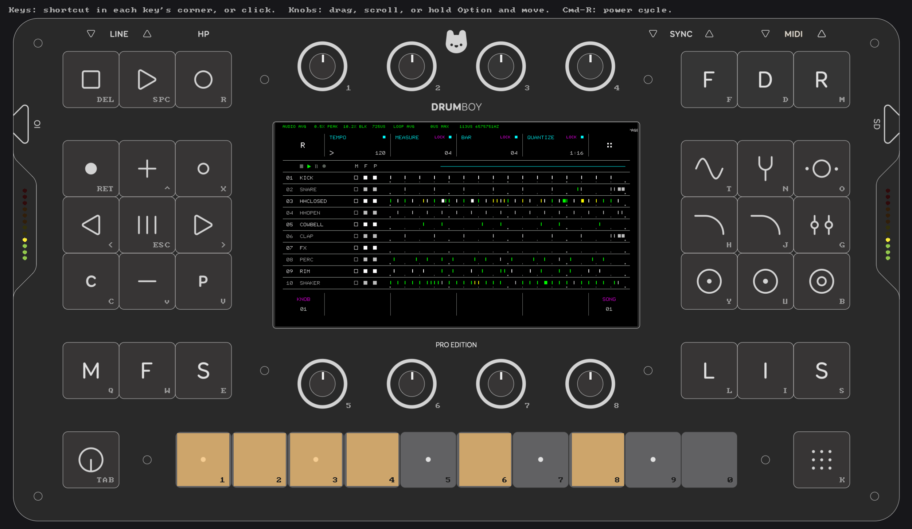
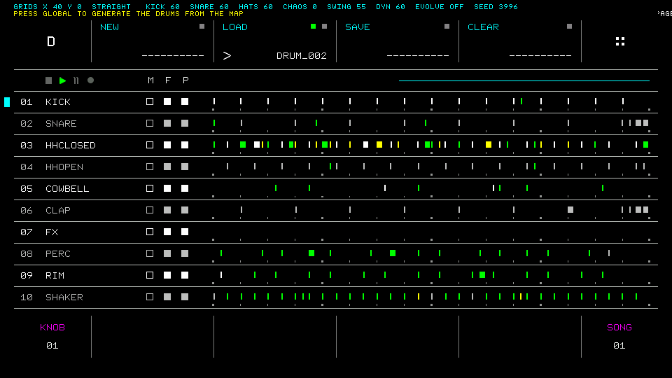
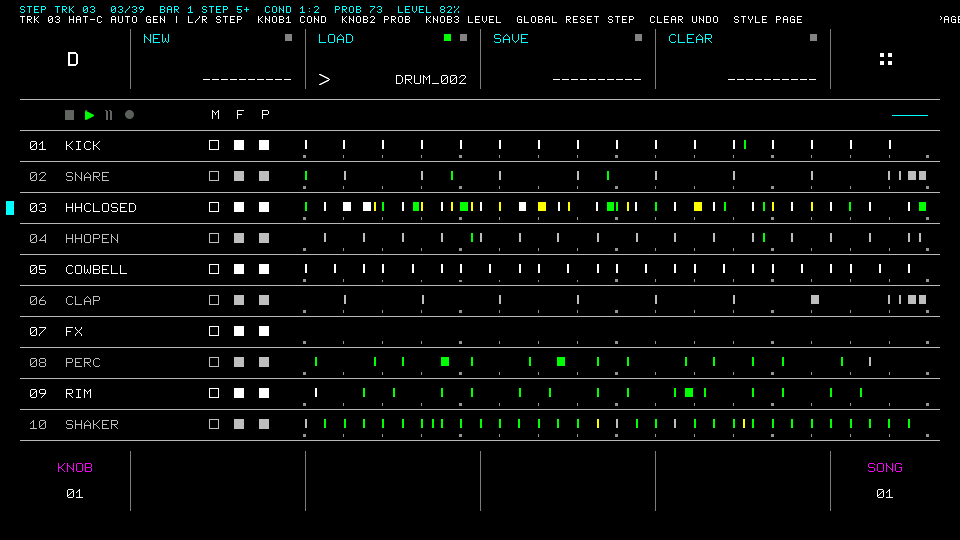
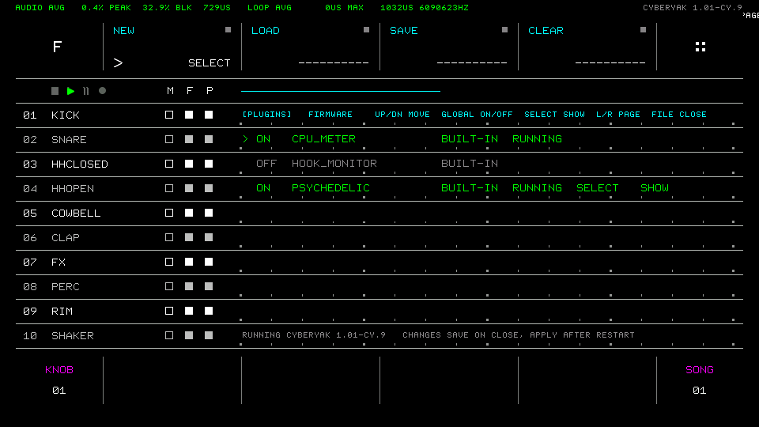
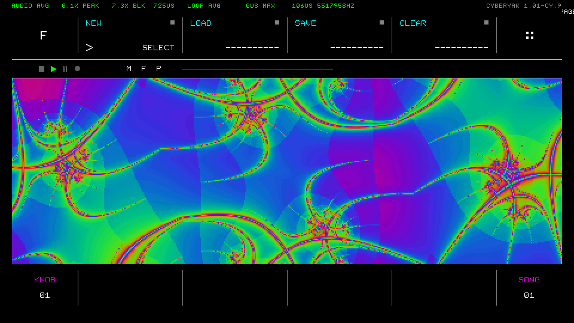

# Drumboy Pro: cyberyak firmware

Custom firmware for the [Randomwaves Drumboy Pro](https://www.randomwaves.io) groovebox, built on the official open-source firmware. It adds a pattern generator, a plugin system with a built-in manager, audio-reactive visuals and a desktop simulator. With every plugin switched off it behaves exactly like stock.

**Latest release:** [1.01-cy.9](https://github.com/cyberyak/Drumboy-Pro/releases/latest) · [Install guide](docs/getting-started.md) · [Documentation](docs/README.md) · [Changelog](CHANGELOG.md)



## What's new

| | |
|---|---|
|  |  |
| **Pattern generator:** style-based patterns (GEN), a Grids-style X/Y map (GRIDS), Euclidean rhythms (EUCLID), and per-beat trig conditions, probability and level (STEP). Undo, history, EVOLVE, and everything is saved with your File. | **Trig conditions** in the style of Elektron and OXI: A:B, FILL, FIRST, PRE and their opposites. They work on generated and hand-made beats. |
|  |  |
| **Plugin & Firmware Manager:** switch plugins on and off, and install any firmware from the SD card, stock included, without a computer. | **Psychedelic visualizer:** full-screen visuals that react to the music, with 8 knobs to shape them. The sequencer keeps playing. |

Also:
- **Desktop simulator** for macOS: the real firmware with the front panel, sound and scripted tests. See [Simulator](docs/simulator.md).
- **CPU Meter** and **Hook Monitor** plugins, and a plugin host with hooks for steps, notes, keys, knobs, MIDI and audio.
- **Safety fixes** ported from [daupuck's fork](https://github.com/daupuck/Drumboy-Pro-Moffe-Edition), for long file names, truncated WAVs, full SD cards and a fail-safe bootloader update.
- A `Stock` build that is byte-identical to the official firmware, which shows the hooks change nothing.

More in the [feature tour](docs/features.md).

## Install

1. Download `Drumboy_Pro_Fw_01_01_cy09.bin` from the [latest release](https://github.com/cyberyak/Drumboy-Pro/releases/latest).
2. Copy it to the root of the SD card. It must be the only firmware file there.
3. Optional: copy `plugins.txt` to `Plugins/plugins.txt` on the card to switch plugins on.
4. Power-cycle. The File menu then shows `CYBERYAK 1.01-CY.9` in the top-right corner.

To go back to stock, do the same with the official `Drumboy_Pro_Fw_01_01.bin` (attached to every release), or use the manager. Back up your SD card first. Details: [Getting started](docs/getting-started.md).

## Documentation

| | |
|---|---|
| [Getting started](docs/getting-started.md) | Install, update, go back to stock, SD card layout, key names |
| [Features](docs/features.md) | A tour of everything above, with screenshots |
| [Simulator](docs/simulator.md) | Run and test the firmware on a Mac |
| [Development](docs/development.md) | Build, version, release, memory budget, known issues |
| [Plugin development guide](02%20Software/Drumboy-Pro-App-H723/Core/Plugin/README.md) | Write your own plugin |

## Status

- **Released:** 1.01-cy.9, the first release with the simulator, the generator pages and the safety fixes.
- **In progress:** KeyStep Pro MIDI FX on [`feature/keystep-fx`](https://github.com/cyberyak/Drumboy-Pro/tree/feature/keystep-fx). It isn't in any release yet.

## Credits

Drumboy Pro hardware and firmware by [Randomwaves](https://www.randomwaves.io), released under the [MIT License](LICENSE). This fork is unofficial and not supported by Randomwaves. Safety fixes ported from [daupuck/Drumboy-Pro-Moffe-Edition](https://github.com/daupuck/Drumboy-Pro-Moffe-Edition). Upstream: [Randomwaves/Drumboy-Pro](https://github.com/Randomwaves/Drumboy-Pro).

---

<details open>
<summary><b>Original Randomwaves README</b>, unchanged from <a href="https://github.com/Randomwaves/Drumboy-Pro">Randomwaves/Drumboy-Pro</a></summary>

# Drumboy Pro

📖 **[Developer Wiki](https://www.randomwaves.io/drumboy-pro/drumboy-pro-wiki.html)** — full hardware specs, schematics walkthrough, firmware architecture, DSP internals, and memory map.

**An open-source hardware groovebox** — sequencer, sampler, and DSP effects engine built around an STM32H723 (Cortex-M7 @ 550 MHz), with a 540×960 touch-free color display, 42 keys, 8 rotary encoders, and full MIDI/Sync I/O.

This repository holds the complete hardware design (KiCad) and firmware (STM32CubeIDE / C++) for Drumboy Pro, released by [Randomwaves](https://randomwaves.io) as an open hardware/software project.


---

## Overview

The MCU sits at the center of six subsystems: an NT35510 display driven over a 16-bit parallel GPIO bus, 16 MB of external SDRAM for sample streaming, an SGTL5000 audio codec over I2S/I2C, a microSD card for storage, a control surface fanned out over six MCP23017 I/O expanders, and external connectivity (MIDI, Sync, USB-C power).

| | |
|---|---|
| **MCU** | STM32H723ZGT6 — Cortex-M7 @ 550 MHz (VOS0), LQFP-144 |
| **Display** | NT35510, 540×960, 16-bit parallel |
| **SDRAM** | 16 MB (IS42S16800J-7TL-TR), FMC bus |
| **Audio codec** | SGTL5000 — I2S3 audio / I2C3 control |
| **Storage** | microSD (TF-01A), SDMMC2, FAT filesystem |
| **Control surface** | 42 keys, 42 LEDs, 8 rotary encoders — 6× MCP23017 over I2C |
| **Connectivity** | MIDI In/Out, Sync In/Out, USB-C power |
| **Flash** | 1024 KB, split between bootloader and application |

## Features

- **10 sample layers**, each independently modulated by a 10-slot LFO matrix (sample-and-hold at note-trigger time)
- **Per-layer routing** into a shared DSP chain: parametric EQ → 2× multimode filter → 2× send effect → stereo reverb
- **9 effect types** per send slot: Delay, Chorus, Flanger, Phaser, Compressor, Expander, Overdrive, Distortion, Bitcrusher
- **Freeverb/Schroeder-Moorer style reverb** with pre-delay and stereo surround derivation
- **Sequencer** with 5 song banks per layer, 64 beats per bank, and algorithmic complex-fill generation (timing alignment × level curve templates)
- **MIDI In/Out** (opto-isolated input) and **Sync In/Out** for external clock/gate sync
- **SD-card firmware updates** via a dedicated bootloader with CRC-32 verified staged writes
- Fully open hardware (KiCad) and firmware (C/C++ against the STM32 HAL) — no CMSIS-DSP or external DSP library, all hand-rolled biquad/delay-line DSP on the Cortex-M7 FPU

## Repository structure

```
01 Hardware/
  Main/       KiCad project — main board (Drumboy_Main)
  Top/        KiCad project — top/control-surface board (Drumboy_Top)
  Drawing/    Mechanical drawings, enclosure models, graphics, fonts

02 Software/
  Drumboy-Pro-Boot-H723/   Bootloader — STM32CubeIDE project (own repo, linked below)
  Drumboy-Pro-App-H723/    Application firmware — STM32CubeIDE project (own repo, linked below)
  Firmware/                 Prebuilt firmware binaries
  Sd Card/                  Reference SD card contents (samples, presets, drumkits, system data)
```

### Related repositories

Firmware is split into two independently-built projects that share one flash device — a bad application build can never brick the update path:

| Project | Responsibility |
|---|---|
| [Drumboy-Pro-Boot-H723](https://github.com/Randomwaves-Team/Drumboy-Pro-Boot-H723) | Checks the SD card for a firmware package, validates and programs it, then jumps to the application |
| [Drumboy-Pro-App-H723](https://github.com/Randomwaves-Team/Drumboy-Pro-App-H723) | The sequencer, DSP engine, UI, and all runtime behavior |

## Hardware

Designed in **KiCad 7**. Open `01 Hardware/Main/Drumboy_Main.kicad_pro` for the main board, or `01 Hardware/Top/Drumboy_Top.kicad_pro` for the control-surface board. All third-party symbols, footprints, and 3D models are vendored under each project's `Library/` folder.

Mechanical design (enclosure and 3D model) lives in `01 Hardware/Drawing/` as **Rhinoceros 8** files — `Drumboy Pro 2D.3dm` and `Drumboy Pro 3D.zip` (zipped to keep it under GitHub's file size limit; unzip to get the `.3dm`).

A full BOM is generated from KiCad at `production/bom.csv`. See the [wiki](https://www.randomwaves.io/drumboy-pro/drumboy-pro-wiki.html) for the annotated schematic walkthrough, clock tree, power-domain isolation scheme, and key component reference.

## Firmware

Built with **STM32CubeIDE**, written in C/C++ against the STM32 HAL.

- Bootloader owns flash sector 0 (`0x08000000`–`0x0801FFFF`)
- Application owns sectors 1–7 (`0x08020000`–`0x080FFFFF`), with the vector table relocated at startup

To flash over SWD, wire an ST-Link V2 to the board's `SWDIO` (PA13), `SWCLK` (PA14), and `GND` pins, then build and flash from STM32CubeIDE. See the wiki's [Build, Flash & Debug](https://www.randomwaves.io/drumboy-pro/drumboy-pro-wiki.html) section for details.

## License

Released under the [MIT License](LICENSE).

## Community

- 💬 [Discord community](https://discord.gg/5atevNH6UU) — join the discussion
- 🌐 [randomwaves.io](https://www.randomwaves.io)
- ✉️ [hello@randomwaves.io](mailto:hello@randomwaves.io)

</details>
