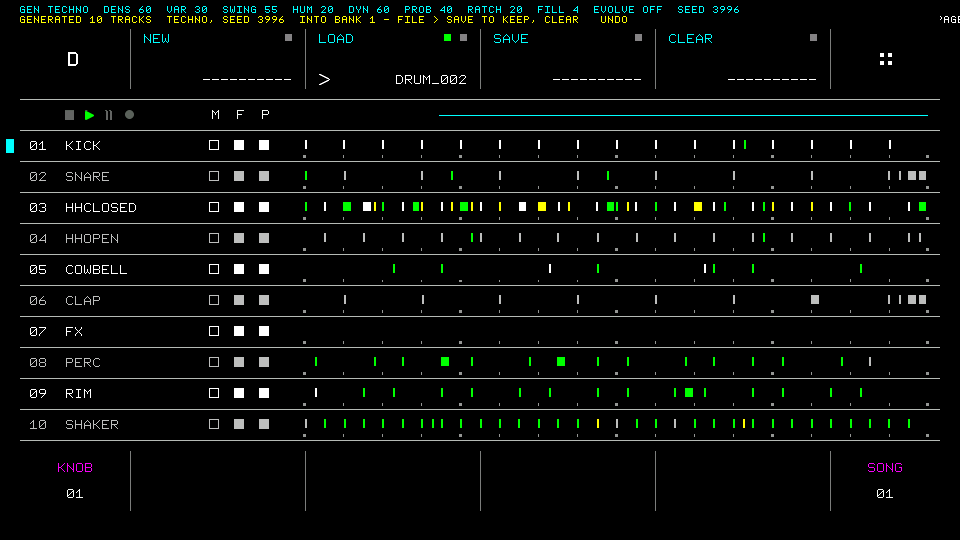
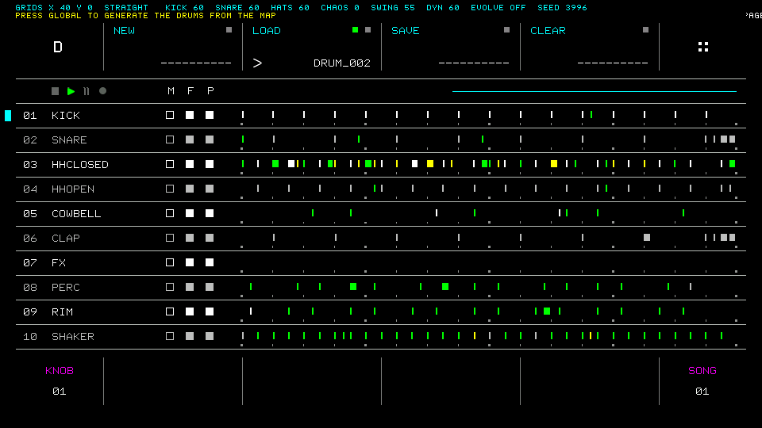
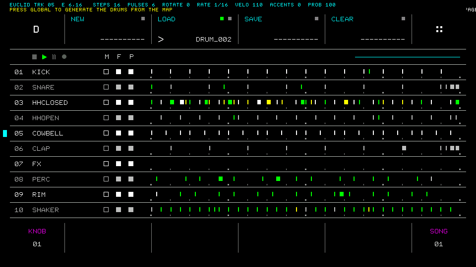
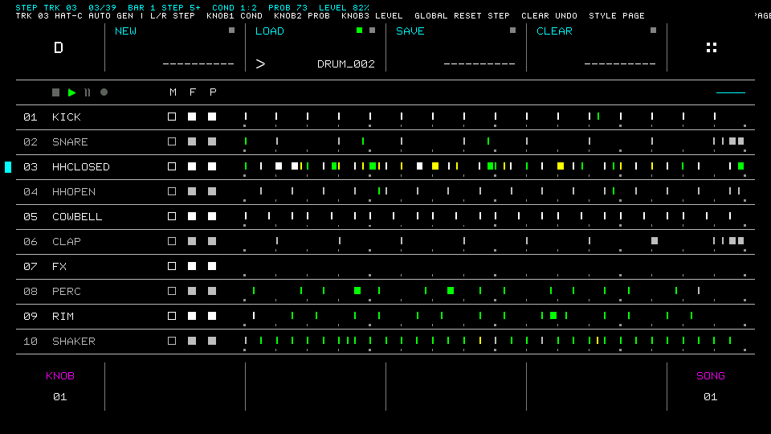
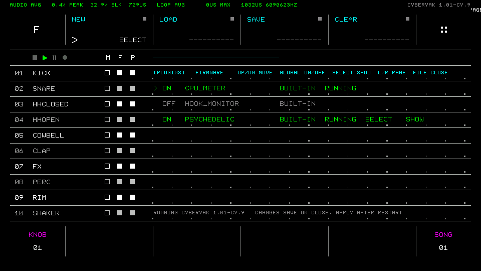
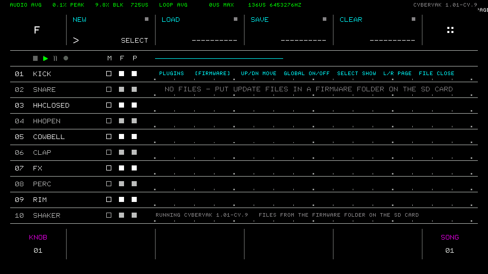
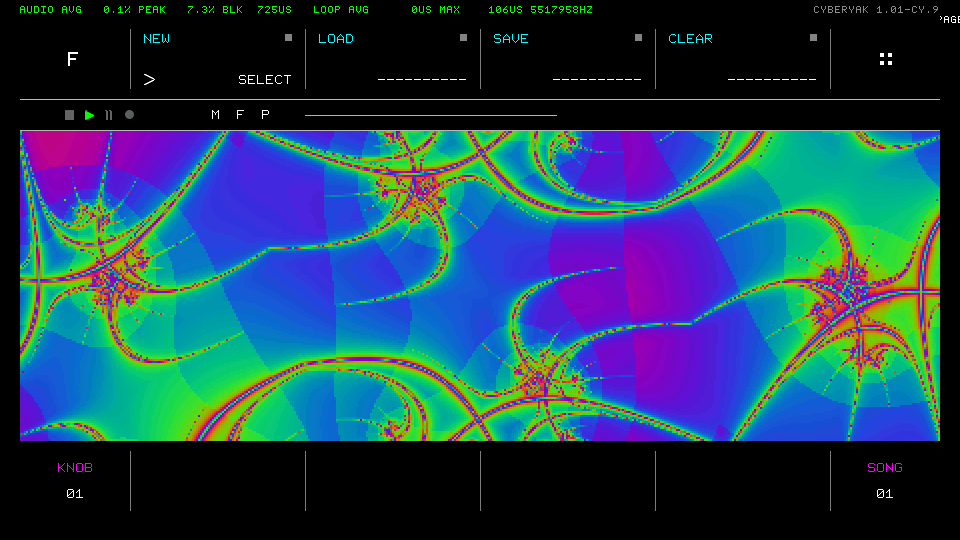
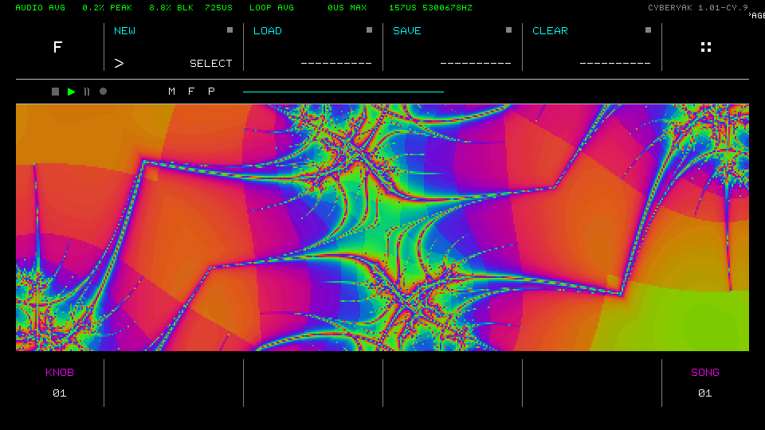
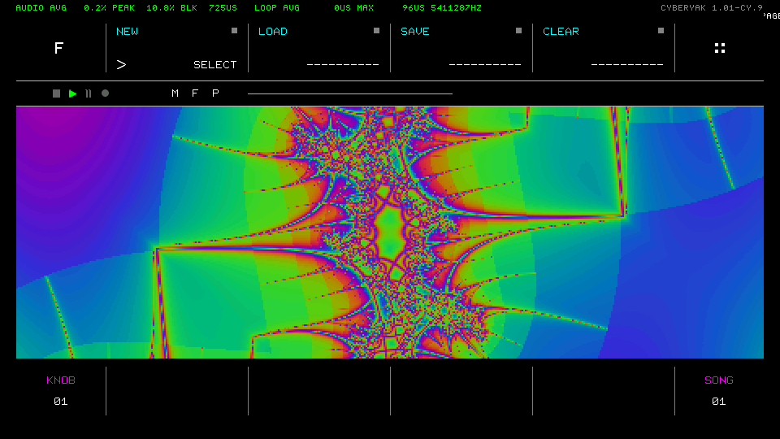
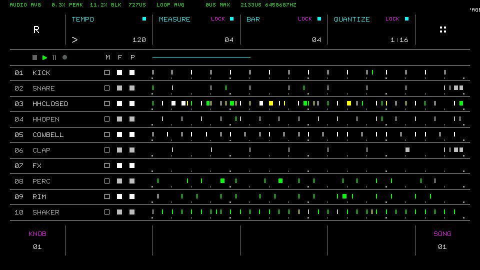

# Features

A tour of what the cyberyak firmware adds to the stock Drumboy Pro. All screenshots come from the [simulator](simulator.md), which runs the same firmware. For release-by-release details, see the [CHANGELOG](../CHANGELOG.md).

- [Pattern generator](#pattern-generator): GEN, GRIDS, EUCLID and STEP pages
- [Plugin & Firmware Manager](#plugin--firmware-manager)
- [Psychedelic visualizer](#psychedelic-visualizer)
- [CPU Meter and Hook Monitor](#cpu-meter-and-hook-monitor)
- [Plugin host](#plugin-host)
- [Fixes](#fixes)

## Pattern generator

Hold **FILL** and press **STYLE** from any menu. The settings appear in the top strip, and the song lanes stay visible and update as you generate. **STYLE** goes to the next page, and **FILL + STYLE** or **FILE** closes the generator. Playback keeps running.

Generating changes the current song bank in memory only. To get the old pattern back, press **CLEAR** (undo) or reload the File. **File → SAVE** keeps the result, including the per-step probability, velocity and trig conditions the stock format can't store. Stock firmware still loads these Files.

On every page: **UP/DOWN** or a layer key selects a track, **SELECT** locks it, **COPY** changes its role, **SONG** sets the phrase fill and **REC** sets EVOLVE, which re-rolls details every 4 or 8 bars while playing. Full reference: [Generator.md](../02%20Software/Drumboy-Pro-App-H723/Core/Plugin/Generator.md).

### GEN: style-based patterns for all tracks

Knobs: STYLE (techno, electro, breakbeat), DENSITY, VARIATION, SWING, HUMANIZE, DYNAMICS, PROBABILITY, RATCHET. **GLOBAL** generates, **PASTE** uses a new seed, **MUTE** re-rolls only the selected track, and **LEFT/RIGHT** step through the last 8 patterns.

### GRIDS: kick, snare and hats from an X/Y map

**X** goes from minimal to busy, **Y** from straight to electro to broken. KICK, SNARE and HATS set each density, and CHAOS varies the weaker hits from bar to bar. Turning a knob updates the tracks live.

### EUCLID: Euclidean rhythms per track

E(pulses, steps) with rotation, rate (1/32 to 1/4, with triplets), velocity, evenly spread accents and probability for the hits without an accent. Edits are live, and the track is locked so GEN and GRIDS leave it alone.

### STEP: trig conditions, probability and level per beat

**LEFT/RIGHT** select a beat, which shows white in its lane. Knob 1 sets its **trig condition**: A:B (play on loop A of every B), FILL / NOT FILL, FIRST / NOT FIRST, or PRE / NOT PRE. Beats with a condition are drawn magenta. This page works on hand-made beats too.

## Plugin & Firmware Manager

Press **FILE** to open the File menu, then press **FILE** again. The manager draws over the song lanes while playback continues.

| Plugins page | Firmware page |
|---|---|
|  |  |
| **GLOBAL** switches a plugin on or off, and the change applies after a restart. **SELECT** starts a plugin's show mode. Closing the manager saves `Plugins/plugins.txt`. | Lists the update files in the card's `Firmware/` folder. Press **GLOBAL** twice: the manager checks the file (header and CRC), copies it to the card root and restarts, and the bootloader installs it. Use it to switch between cyberyak builds and stock. |

Reference: [Manager.md](../02%20Software/Drumboy-Pro-App-H723/Core/Plugin/Manager.md).

## Psychedelic visualizer

Full-screen visuals that keep evolving and react to the audio, drawn over the track area while the sequencer keeps playing. Switch `psychedelic` on, restart, then go to the manager, select `psychedelic` and press **SELECT**. **FILE** returns to the normal screen.

| | | |
|---|---|---|
|  |  |  |

The 8 knobs control MODE (AUTO, JULIA, PLASMA, WARP, KALEIDO), SPEED, ZOOM, COLOUR, DETAIL, REACTION, SYMMETRY and PALETTE. Reference: [Psychedelic.md](../02%20Software/Drumboy-Pro-App-H723/Core/Plugin/Psychedelic.md).

## CPU Meter and Hook Monitor

- **CPU Meter** (`cpu_meter`) shows the audio and main-loop load in the top-left strip, as in the screenshot above. It turns red above 80%, where clicks start. Measured on the device, all 10 tracks with effects use about 30% of the audio budget. Reference: [CpuMeter.md](../02%20Software/Drumboy-Pro-App-H723/Core/Plugin/CpuMeter.md).
- **Hook Monitor** (`hook_monitor`) is a developer tool. It shows the latest step, note, key, encoder and MIDI event on one line. Reference: [HookMonitor.md](../02%20Software/Drumboy-Pro-App-H723/Core/Plugin/HookMonitor.md).

## Plugin host

The firmware has hooks at the points that matter (steps, notes, beats about to play, keys, encoders, MIDI in and out, the audio output, frames, and File save and load), an event queue, and a show canvas a plugin can take over. Plugins are C++ classes compiled into the firmware and switched on in `plugins.txt`. With every hook compiled out (the `Stock` build), the firmware is byte-identical to the official one. To write a plugin, see the [plugin development guide](../02%20Software/Drumboy-Pro-App-H723/Core/Plugin/README.md).

## Fixes

Safety fixes ported from [daupuck/Drumboy-Pro-Moffe-Edition](https://github.com/daupuck/Drumboy-Pro-Moffe-Edition) (in 1.01-cy.9):

- Instrument file names over 25 characters no longer overflow into the folder name.
- A truncated WAV file can't stall the device.
- When the SD card is full, saving shows the save error instead of losing data quietly.
- The bootloader's update is fail-safe: it checks the app before jumping to it and never jumps after a failed write. This fix only reaches a device whose bootloader is flashed over SWD, because SD-card updates never change the bootloader.
