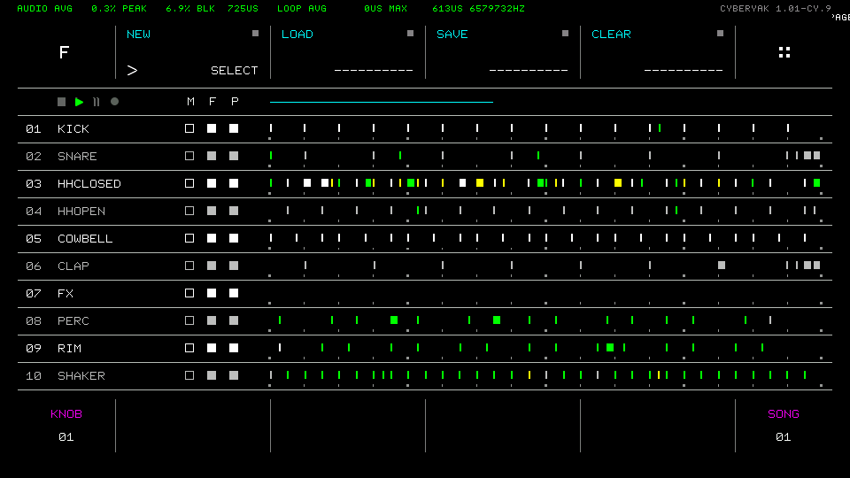

# Getting started

The cyberyak firmware replaces the application firmware on your Drumboy Pro. It installs from the SD card like an official update, and you can go back to stock the same way. With every plugin switched off it behaves exactly like stock, apart from a version label in the File menu.

## Install

1. Download `Drumboy_Pro_Fw_01_01_cyNN.bin` from the latest [GitHub release](https://github.com/cyberyak/Drumboy-Pro/releases), or [build it](development.md#building).
2. Copy it to the **root** of the SD card. It must be the only firmware file there. On a Mac, use `cp -X` and delete any `._*` files.
3. Optional: copy the release's `plugins.txt` to `Plugins/plugins.txt` on the card. Without it, every plugin stays off.
4. Put the card back in and power-cycle. The bootloader shows `UPDATING FIRMWARE`, checks the CRC, flashes the firmware and moves the file to `System/Firmware/`.

To check what's running, open the File menu. The top-right corner shows `CYBERYAK 1.01-CY.9`.



> **Back up your SD card first.** Since 1.01-cy.7, File → SAVE appends generator data to your Files (`.rwf`). Stock firmware still loads them, but back up before trying a new build.

## Go back to stock

Copy the official `Drumboy_Pro_Fw_01_01.bin` to the SD card root and power-cycle. It's attached to every release and is also in `02 Software/Firmware/`. You can also switch firmware from the manager's [Firmware page](features.md#plugin--firmware-manager).

Notes:
- The bootloader only accepts file names up to 32 characters. It empties `System/Firmware/` on every update, so keep your firmware library in `Firmware/` instead.
- An SD-card update never changes the bootloader. Recovering a broken bootloader needs an ST-Link.

## SD card layout

The cyberyak firmware adds two folders next to the stock ones:

```
Plugins/
  plugins.txt           which plugins run ("id = on|off"), rewritten by the manager
  README.md             on-device controls
Firmware/
  Drumboy_Pro_Fw_01_01.bin          stock, for the manager's Firmware page
  Drumboy_Pro_Fw_01_01_cy09.bin     cyberyak builds
  README.md
```

`plugins.txt`:

```
cpu_meter = off        # Audio and main-loop CPU load (green line, top-left)
hook_monitor = off     # Developer view of step/note/key/encoder/MIDI events (cyan line)
psychedelic = off      # Full-screen evolving psychedelic visuals (show mode: manager -> SELECT)
```

Changes apply after a restart. A missing file, or a plugin that isn't listed, means off. The easiest way to switch plugins is the [manager](features.md#plugin--firmware-manager), which rewrites this file for you. The pattern generator and the manager are part of the firmware and always available.

## Key names

The code uses internal names for keys, but two keys have different names printed on the device. The docs use the **printed** names.

| Printed on the device | In the code (left keypad index) |
|---|---|
| SELECT (left of UP) | `ADD` (3) |
| GLOBAL (between LEFT and RIGHT) | `CENTER` (7) |

Other left-keypad indices: RESET 0, PLAY/STOP 1, REC 2, UP 4, CLEAR 5, LEFT 6, RIGHT 8, COPY 9, DOWN 10, PASTE 11, MUTE 12, FILL 13, STYLE 14, SONG 15. FILE is index 0 on the right keypad.

## Quick reference

| To | Press |
|---|---|
| Open the pattern generator | Hold **FILL** + press **STYLE** |
| Next generator page (GEN → GRIDS → EUCLID → STEP) | **STYLE** |
| Close the generator | **FILL + STYLE** or **FILE** |
| Open the Plugin & Firmware Manager | **FILE**, then **FILE** again |
| Switch a plugin on/off (then restart) | Manager → **GLOBAL** |
| Start the visualizer | Manager → `psychedelic` → **SELECT**; **FILE** ends it |
