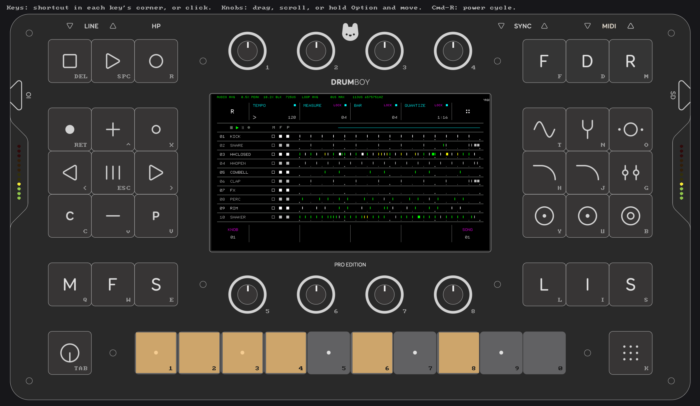

# Simulator

The simulator runs the real application firmware on a Mac, with no device needed. You can play it in a window that shows the front panel, or run it headless from a script or a control socket to test changes before flashing. The firmware sources compile unchanged; only the hardware layer is replaced.



- **Window:** the official panel drawing with the live LCD, LEDs and sound. Every key has a keyboard shortcut (printed in its corner), knobs turn by dragging or scrolling, and **Cmd-R** power-cycles.
- **Headless:** scripts press keys, turn knobs, take screenshots, record audio and check the firmware's state. `Simulator/tests/*.sim` are the functional tests.
- **Firmware problems:** it reports `sprintf` overflows, crashes and (optionally) stack overruns that would go unnoticed on the device.

Full reference (commands, options, internals): [Simulator/README.md](../02%20Software/Drumboy-Pro-App-H723/Simulator/README.md).

## Quick start

Requirements: macOS, Xcode command-line tools, CMake and Ninja. Install them with `brew install cmake ninja`, or let the scripts use the copies the STM32 VS Code extension bundles. The first build downloads SDL3.

```sh
cd "02 Software/Drumboy-Pro-App-H723"
cmake --preset Simulator
cmake --build --preset Simulator

# Once: a card image from the reference SD card contents in the repo (or your own card backup)
Simulator/tools/make_card_image.sh "../Sd Card" ~/Library/Application\ Support/DrumboySim/drumboy.img

# Play it
Simulator/tools/run_sim.sh
```

The simulator is an x86_64 binary because the firmware keeps hardware addresses below 4 GB. On Apple silicon it runs under Rosetta.

## Card images

Card images live outside the repo, so all checkouts share them. Default folder: `~/Library/Application Support/DrumboySim`.

| Variable | Default | Used for |
|---|---|---|
| `DRUMBOY_SIM_DATA` | `~/Library/Application Support/DrumboySim` | Folder for the two images below |
| `DRUMBOY_SIM_CARD` | `$DRUMBOY_SIM_DATA/drumboy.img` | The card you play with |
| `DRUMBOY_SIM_TEST_CARD` | `$DRUMBOY_SIM_DATA/test.img` | The card the tests run on |
| `DRUMBOY_SD_BACKUP` | none | SD card folder used to create the test card if it's missing |

Add `--card-copy` to `run_sim.sh` to start from a fresh copy, so nothing the firmware saves stays on the image.

## Tests

```sh
Simulator/tools/run_tests.sh      # every Simulator/tests/*.sim, prints PASS/FAIL
```

| Test | Checks |
|---|---|
| `smoke` | Boot, main page, Rhythm page, transport and audio |
| `kit_pattern` | Loads a drumkit, plays pads with sound, records a pattern live |
| `plugin_manager` | Opens the manager, switches plugins, saves `plugins.txt` |
| `generator_pages` | Opens the generator, generates, visits GRIDS, EUCLID and STEP, plays the result |

Each test runs on a throwaway copy of the test card. Logs, screenshots and recordings go to `build/Simulator/test-output/<test>/`.

## Screenshots for these docs

```sh
Simulator/tools/docs_screenshots.sh      # writes docs/images/*.png
```

It works on a throwaway copy of your playing card. It switches the CPU meter and the visualizer on, then runs `Simulator/tools/docs_screenshots.sim` (headless) and `docs_panel.sim`, which briefly opens the window for `simulator_panel.png`. Run it again whenever a screen in the docs changes.
